

  <picture><source media="(prefers-color-scheme: dark)" srcset="./assets/hero-dark.svg"><source media="(prefers-color-scheme: light)" srcset="./assets/hero-light.svg"></picture>

  <a href="https://abilaash.in"><b>abilaash.in</b></a> &nbsp;·&nbsp;
  <a href="https://www.linkedin.com/in/abilaash-s-s-59254724b/">LinkedIn</a> &nbsp;·&nbsp;
  <a href="mailto:abilaashss14@gmail.com">Email</a>

 

  <picture><source media="(prefers-color-scheme: dark)" srcset="./assets/now-bny-dark.svg"><source media="(prefers-color-scheme: light)" srcset="./assets/now-bny-light.svg"></picture>&nbsp;&nbsp;
  <a href="https://revyn.in"><picture><source media="(prefers-color-scheme: dark)" srcset="./assets/now-revyn-dark.svg"><source media="(prefers-color-scheme: light)" srcset="./assets/now-revyn-light.svg"></picture></a>

 

<h3 align="center">Selected work</h3>

  <a href="https://github.com/Abilaashss/FinSense"><picture><source media="(prefers-color-scheme: dark)" srcset="./assets/tile-finsense-dark.svg"><source media="(prefers-color-scheme: light)" srcset="./assets/tile-finsense-light.svg">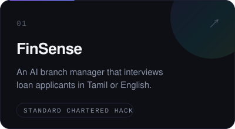</picture></a>&nbsp;&nbsp;
  <a href="https://github.com/Abilaashss/AWS-Hack_AI-For-Bharat"><picture><source media="(prefers-color-scheme: dark)" srcset="./assets/tile-bharat-dark.svg"><source media="(prefers-color-scheme: light)" srcset="./assets/tile-bharat-light.svg">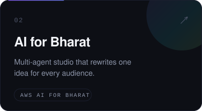</picture></a>&nbsp;&nbsp;
  <a href="https://github.com/Abilaashss/RAG-X"><picture><source media="(prefers-color-scheme: dark)" srcset="./assets/tile-ragx-dark.svg"><source media="(prefers-color-scheme: light)" srcset="./assets/tile-ragx-light.svg">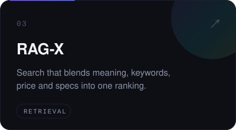</picture></a>

  <a href="https://github.com/Abilaashss/PaperPulse"><picture><source media="(prefers-color-scheme: dark)" srcset="./assets/tile-paperpulse-dark.svg"><source media="(prefers-color-scheme: light)" srcset="./assets/tile-paperpulse-light.svg">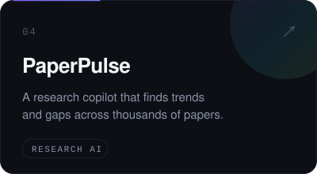</picture></a>&nbsp;&nbsp;
  <a href="https://github.com/Abilaashss/GradeA-gent"><picture><source media="(prefers-color-scheme: dark)" srcset="./assets/tile-gradea-dark.svg"><source media="(prefers-color-scheme: light)" srcset="./assets/tile-gradea-light.svg">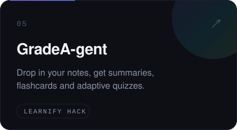</picture></a>&nbsp;&nbsp;
  <a href="https://github.com/Abilaashss/Life-Coach"><picture><source media="(prefers-color-scheme: dark)" srcset="./assets/tile-lifecoach-dark.svg"><source media="(prefers-color-scheme: light)" srcset="./assets/tile-lifecoach-light.svg">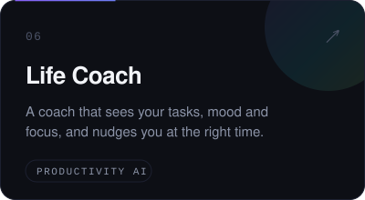</picture></a>

 

<h3 align="center">Toolbox</h3>

  <picture><source media="(prefers-color-scheme: dark)" srcset="./assets/stack-dark.svg"><source media="(prefers-color-scheme: light)" srcset="./assets/stack-light.svg">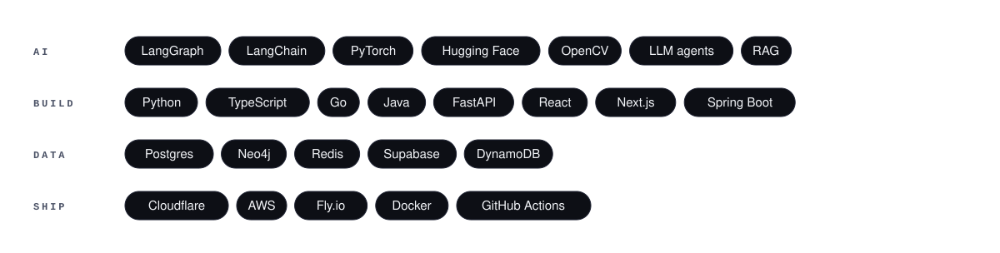</picture>

  Built under the clock at &nbsp;Smart India Hackathon 2024 · Intel Unnati 2024 · Adobe GenSolve · Standard Chartered · AWS AI for Bharat · BNY Service Design Jam · Learnify Hack · AgentHacks

 

  <picture><source media="(prefers-color-scheme: dark)" srcset="./assets/footer-dark.svg"><source media="(prefers-color-scheme: light)" srcset="./assets/footer-light.svg">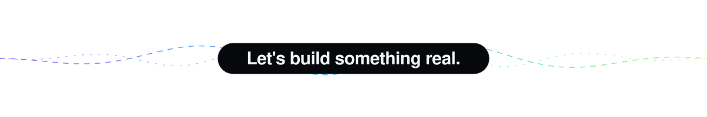</picture>

  <a href="mailto:abilaashss14@gmail.com"><b>Say hello</b></a> &nbsp;·&nbsp;
  <a href="https://revyn.in">revyn.in</a>

