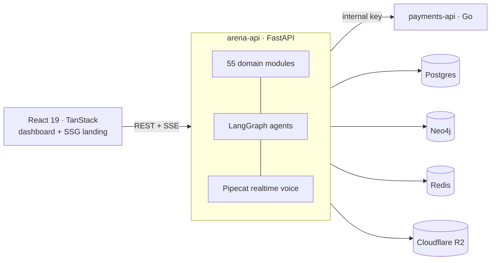

<picture>
  <source media="(prefers-color-scheme: dark)" srcset="./assets/header-dark.svg">
  <source media="(prefers-color-scheme: light)" srcset="./assets/header-light.svg">
  
</picture>

  <a href="https://abilaash.in"><b>abilaash.in</b></a> &nbsp;·&nbsp;
  <a href="https://revyn.in">revyn.in</a> &nbsp;·&nbsp;
  <a href="https://www.linkedin.com/in/abilaash-s-s-59254724b/">LinkedIn</a> &nbsp;·&nbsp;
  <a href="mailto:abilaashss14@gmail.com">abilaashss14@gmail.com</a>

 

I'm a CS student at SRMIST who ships production software. My best work right now is **Revyn**, an AI sales-intelligence platform: reps practise live calls against voice AI buyers, managers see who's ready, and an agent works across every deal. I build the whole request path, from the React client and the FastAPI and LangGraph core down to the Go billing service and the Postgres schema.

I like problems where an LLM is one part of a system that still has to be correct, fast and cheap.

 

## Now: building [Revyn](https://revyn.in)

<table>
<tr>
<td width="50%" valign="top">

**Realtime voice**
- Pipecat voice pipeline with a speculative-turn engine that answers in about 1 second
- Bilingual engine built by composing separate STT, LLM and TTS providers, so it covers Tamil, Telugu and Malayalam where off-the-shelf speech-to-speech was English-only
- Outbound AI dialer over telephony, plus call recordings, PII masking and a live calls board

**Agentic core**
- LangGraph deep agent with a policy-gated registry of 29 tools, planning, subagents, long-term memory and context compaction
- Token streaming over **Redis-backed resumable SSE**, so a dropped tab picks up mid-answer
- Effort router that sends each request to the cheapest model that can handle it

</td>
<td width="50%" valign="top">

**Scoring you can trust**
- MEDDPICC deal scoring where the LLM *proposes* evidence and a deterministic layer *decides*, with hard ceilings it can't argue past
- Org knowledge graph on **Neo4j** that grounds roleplay scenarios in a company's own playbook

**Platform**
- Multi-tenant org/personal isolation, custom RBAC roles, SSO and audit trails
- CRM connectors (HubSpot, LeadSquared, Zoom, Slack and more) on one connector interface
- Standalone **Go** billing service: plans, subscriptions, a credit ledger and regional price books behind a payment-provider interface
- Prerendered landing and docs on Cloudflare, and an autofix pipeline that runs a coding agent in CI behind a verification gate

</td>
</tr>
</table>

About 300k lines across 4 services in Python, TypeScript and Go. Since April 2026 I've authored 800+ commits and the schema has been through 114 migrations.

 

## Selected work

| Project | What it does | Built with |
|---|---|---|
| [**FinSense**](https://github.com/Abilaashss/FinSense) | AI branch manager for loan intake: OCR document checks, rule-based agent approvals, and a voice interview in Tamil or English. *Standard Chartered hackathon.* | Whisper · IndicWav2Vec · IndicTrans2 · Llama 3 |
| [**AI for Bharat**](https://github.com/Abilaashss/AWS-Hack_AI-For-Bharat) | Multi-agent content platform: perspective flipping, audience adaptation, and turning rough notes into finished posts. | Next.js 15 · AWS Bedrock · DynamoDB · Transcribe |
| [**RAG-X**](https://github.com/Abilaashss/RAG-X) | Retrieval that fuses semantic, keyword, price and spec strategies into one ranked result, with caching and threaded scoring. | SentenceTransformers · PyTorch |
| [**PaperPulse**](https://github.com/Abilaashss/PaperPulse) | Research copilot over arXiv and Semantic Scholar: summaries, trend detection, gap analysis and hypothesis ideation. | Llama 3 · Node · React |
| [**GradeA-gent**](https://github.com/Abilaashss/GradeA-gent) | Upload any PDF, PPTX or DOCX and get topic summaries, flashcards and quizzes at three difficulty levels. | Next.js · Llama 3 70B |
| [**AgentInk**](https://github.com/Abilaashss/AgentInk) | Multi-agent content writer with custom tools that research, draft and edit in sequence. | CrewAI · Hugging Face |
| [**Life Coach**](https://github.com/Abilaashss/Life-Coach) | Productivity system where the coach can see your tasks, mood and focus sessions together. | Next.js 16 · Gemini |
| [**SIH 2024 Attendance**](https://github.com/Abilaashss/AI-Based-Attendance-System-SIH-24) | Face-recognition attendance system. *Smart India Hackathon 2024.* | face_recognition · OpenCV |

 

## Hackathons and programmes

Smart India Hackathon 2024 · Intel Unnati Industrial Training 2024 · Adobe GenSolve · Standard Chartered · AWS AI for Bharat · BNY Service Design Jam · Learnify Hack · AgentHacks · CodeFest · GrabHack

 

## Toolbox

| Area | Stack |
|---|---|
| **AI** | LangGraph · LangChain · Pipecat · PyTorch · Hugging Face · OpenCV · RAG and evals · Claude, Gemini and Llama APIs |
| **Backend** | Python (FastAPI, async SQLAlchemy, Alembic) · Go · Node · Java (Spring Boot) |
| **Frontend** | React 19 · TypeScript · TanStack Router and Query · Next.js · Tailwind v4 |
| **Data** | Postgres · Neo4j · Redis · Supabase · DynamoDB |
| **Infra** | Cloudflare (Pages, R2, Workers) · Fly.io · AWS · Docker · GitHub Actions |

 

## How I work

- **Put rules around the model.** The LLM suggests and deterministic code decides. If a number shows up on a dashboard, it has to be reproducible.
- **Only claim what the code does.** Every line of marketing copy should trace back to a function that exists.
- **Check the real surface.** I verify with curl on the prerendered HTML, DevTools traces and live end-to-end runs, not just green unit tests.
- **Own the whole path.** Most bugs live at the seams between client, API, worker and database, so I work across all of them.

 

Open to hard AI and infra problems. The fastest way to reach me is <a href="mailto:abilaashss14@gmail.com">email</a>.

